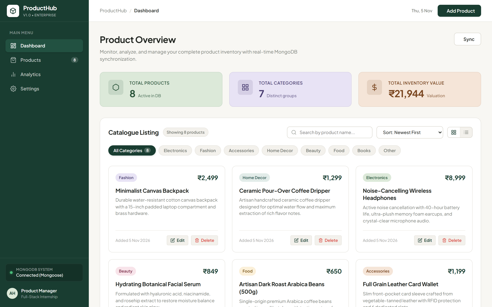
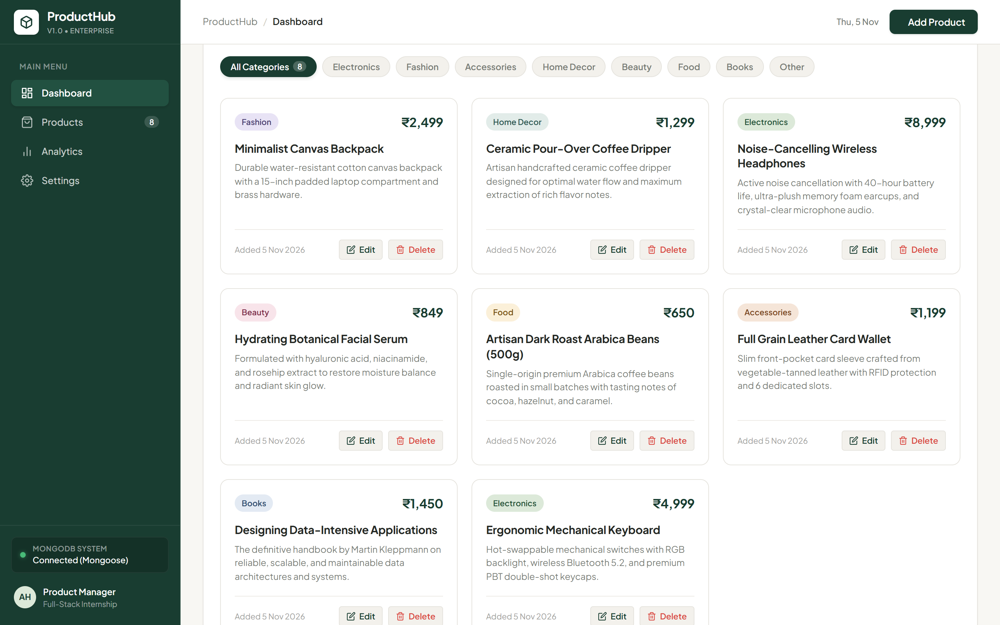
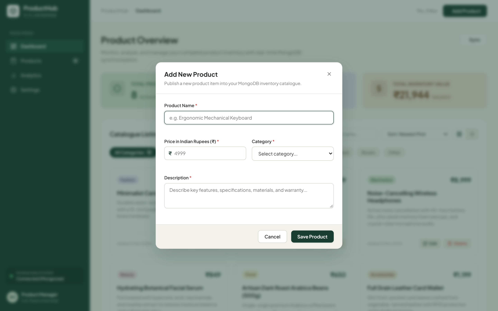
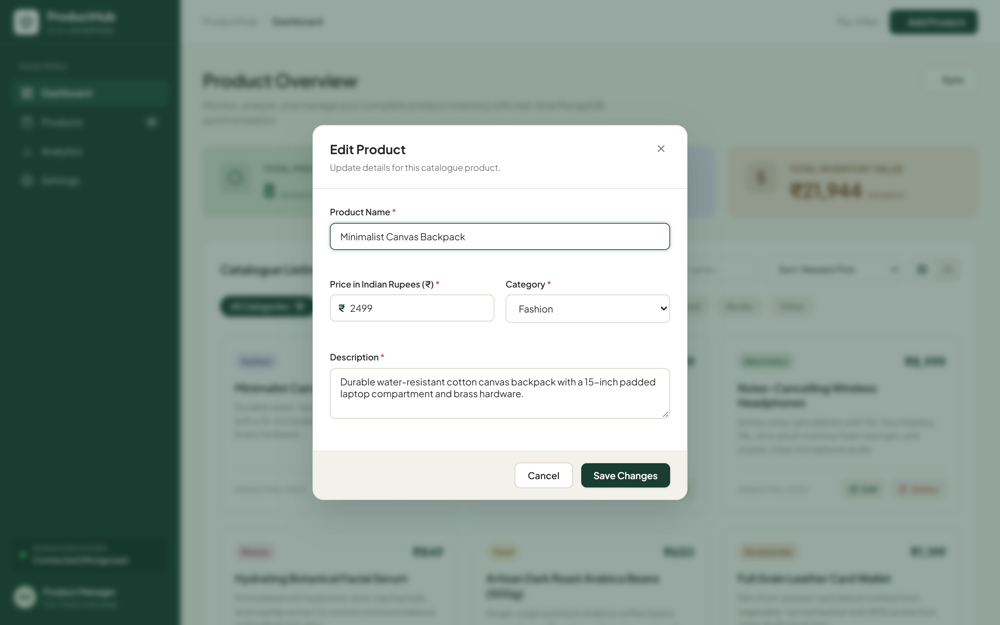
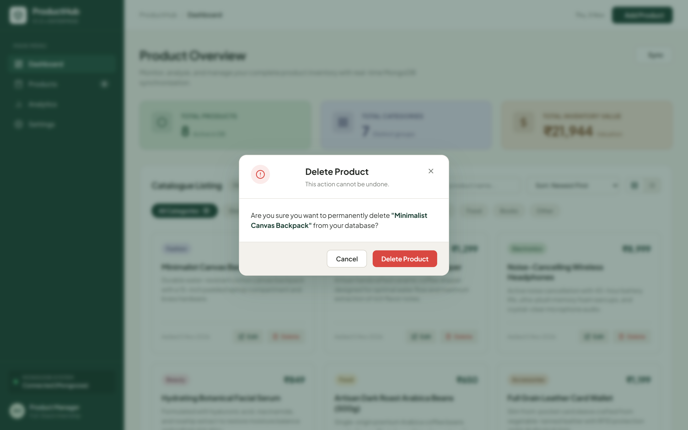
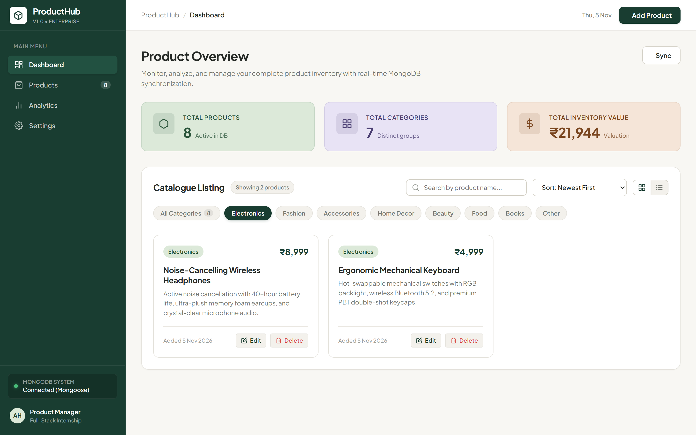

# ProductHub – Full-Stack Product Management System

> **Internship Assignment Submission** • Full-Stack Developer Role  
> Built with HTML5, CSS3, Vanilla JavaScript, Node.js, Express.js, and MongoDB (Mongoose).

---

## 🌟 Project Overview

**ProductHub** is a production-grade, modern minimalist SaaS Product Management System designed specifically to manage, categorize, track, and evaluate product inventories in real time.

Built as a full-stack web application following modern software engineering best practices, ProductHub integrates a responsive, custom-crafted frontend with an Express REST API backend and a persistent MongoDB database via Mongoose ODM.

---

## 📸 Application Screenshots

Genuine captures of the running application are preserved in the [`screenshots/`](screenshots/) directory:

| Main Dashboard Overview | Product Listing Grid |
| :---: | :---: |
|  |  |

| Add Product Modal | Edit Product Modal |
| :---: | :---: |
|  |  |

| Delete Confirmation Dialog | Category Filtering & Real-Time Search |
| :---: | :---: |
|  |  |

---

## 🎨 Design System & Visual Identity

ProductHub follows a **Modern Minimalist SaaS** aesthetic tailored to feel like a modern software product (e.g. Linear, Notion, Raycast), steering clear of generic blue admin templates and excessive animations.

### Color Palette
- **Forest Green** (`#193D31`): Sidebar background, primary action buttons, active navigation indicators.
- **Warm Off-white** (`#F8F7F3`): Main workspace canvas providing high readability and visual warmth.
- **Sage Green** (`#DCE9D9`): Total Products summary card and active electronics category badges.
- **Soft Lavender** (`#E8E3F5`): Total Categories summary card and fashion category badges.
- **Muted Peach** (`#F5E5D8`): Total Inventory Valuation card and accessories category badges.
- **Primary Text** (`#242824`): High-contrast typography for headings and product names.
- **Secondary Text** (`#777B75`): Balanced contrast for descriptions, metadata, and subtitles.

---

## 🚀 Key Features

### 1. Real-Time Dashboard & MongoDB Aggregations
- **Dynamic Metrics**:
  - **Total Products**: Real-time count of all items in MongoDB.
  - **Total Categories**: Real-time count of distinct active categories.
  - **Total Inventory Value**: MongoDB aggregation pipeline (`$sum`) computing total stock value in Indian Rupees (**₹**).
- **Navigation Sidebar**: Quick navigation between Dashboard, Products, Analytics, and Settings, plus live database connection health indicator.

### 2. Product Catalogue Management (CRUD)
- **Product Listing**:
  - Responsive card grid layout with instantaneous toggle to list view.
  - Category badges with distinct pastel colors.
  - Currency formatted in Indian Rupees (**₹**).
  - Clean truncated descriptions and creation timestamps.
  - Direct Edit and Delete action buttons on every card.
- **Search & Filter Engine**:
  - Debounced real-time search matching product names case-insensitively.
  - Category filter pills with live item count badges.
  - Multi-attribute sorting: Newest First, Price (Low to High), Price (High to Low), Name (A-Z), Oldest First.
- **Add Product Modal**:
  - Validation for name, price (> ₹0), category selection, and description.
  - Inline error feedback and submission locking to prevent duplicate entries.
- **Edit Product Modal**:
  - Pre-filled modal with existing document data from MongoDB.
  - Immediate optimistic and server-verified dashboard synchronization.
- **Delete Product Dialog**:
  - Clean modal confirmation highlighting the target product title.
  - Permanent removal from MongoDB with instant UI update and success toast notification.

### 3. Analytics & Diagnostics
- **Category Distribution**: Visual breakdown of inventory proportion per category.
- **Price Diagnostics**: Instant display of highest-priced item, lowest-priced item, and average product price.
- **Toast Notifications**: Floating feedback toasts for successful mutations and server errors.

---

## 🛠️ Technology Stack

| Layer | Technologies |
| :--- | :--- |
| **Frontend** | HTML5 (Semantic), CSS3 (Custom Properties & Flex/Grid), Vanilla JavaScript (ES6+ Modules, Fetch API, DOM manipulation) |
| **Backend** | Node.js (v18+), Express.js (REST API, routing, CORS, JSON middleware) |
| **Database** | MongoDB, Mongoose ODM (Data modeling, schema validation, index optimization, aggregations) |
| **Environment** | Dotenv (configuration separation), Cross-Platform scripts |

---

## 📁 Project Structure

```
product-management-system/
│
├── client/                     # Frontend Client Files
│   ├── index.html              # Semantic HTML5 Application Structure
│   ├── css/
│   │   └── style.css           # Modern Minimalist SaaS Design System
│   └── js/
│       └── app.js              # Vanilla JS Controller & REST Client
│
├── server/                     # Backend Server Files
│   ├── config/
│   │   └── db.js               # MongoDB Connection & Fallback Engine
│   ├── models/
│   │   └── Product.js          # Mongoose Schema & Validation Rules
│   ├── routes/
│   │   └── productRoutes.js    # Express REST API Route Controllers
│   ├── seed.js                 # Database Seeder with Sample Items
│   ├── server.js               # Main Express Server & Static File Host
│   └── package.json            # Server-specific Package Definition
│
├── screenshots/                # Real Screenshots of the Running App
│   ├── dashboard.png           # Main Dashboard Overview
│   ├── product-list.png        # Product Listing Grid
│   ├── add-product.png         # Add Product Modal Dialog
│   ├── edit-product.png        # Edit Product Modal Dialog
│   ├── delete-confirmation.png # Delete Confirmation Dialog
│   └── category-filter.png     # Category Filter & Search
│
├── scripts/
│   └── capture-screenshots.js  # Automated Headless Chrome Screenshot Runner
│
├── .env.example                # Example Environment Variables
├── .gitignore                  # Git Ignore Rules
├── package.json                # Project Root Package Manifest
└── README.md                   # Complete Documentation
```

---

## 📋 Prerequisites

Before running the application, ensure you have:
- **Node.js** (v18.0.0 or higher recommended)
- **npm** (v9.0.0 or higher)
- **MongoDB** (Optional: local MongoDB daemon on port 27017 or MongoDB Atlas URI; if not installed, ProductHub's embedded engine runs out-of-the-box!)

---

## ⚙️ Installation & Setup

### 1. Clone or Extract the Repository
```bash
git clone <repository-url>
cd ProductHub
```

### 2. Install Dependencies
Install all required backend and development dependencies:
```bash
npm install
```

### 3. Configure Environment Variables
Copy the `.env.example` file to create your `.env` file:
```bash
cp .env.example .env
```
*(On Windows PowerShell, run: `Copy-Item .env.example .env`)*

Inside `.env`, customize your configuration if needed:
```env
PORT=5000
NODE_ENV=development

# For local MongoDB installation:
MONGODB_URI=mongodb://127.0.0.1:27017/producthub

# Or for MongoDB Atlas Cloud:
# MONGODB_URI=mongodb+srv://<username>:<password>@cluster0.mongodb.net/producthub?retryWrites=true&w=majority
```

> **Zero-Configuration Guarantee**: If no external MongoDB server is running on port 27017, ProductHub's built-in database connector automatically initializes an embedded, disk-persisted MongoDB storage engine in `.mongodb_data/`. The app works 100% out of the box with persistent storage across restarts!

---

## 🏃 Running the Application

### Start the Server
Run the unified start command:
```bash
npm start
```

You will see the console confirmation:
```
===============================================
  🚀 ProductHub Server running on port 5000
  🌐 Frontend: http://localhost:5000
  🔌 API Base: http://localhost:5000/api/products
===============================================
```

### Access the Application
Open your web browser and navigate to:
```
http://localhost:5000
```

---

## 🧪 Seeding & Testing

### Seed Sample Data
To populate the database with 8 diverse, realistic products across all categories:
```bash
npm run seed
```

### Automatic Initial Seeding
When the application starts for the first time on a fresh database, it automatically populates the initial catalogue so evaluators can inspect the product cards immediately.

---

## 📡 REST API Reference

All API endpoints return standard JSON responses:

### 1. Retrieve Products
- **`GET /api/products`**
  - **Query Parameters**:
    - `search` (string): Filters product name by case-insensitive pattern.
    - `category` (string): Filters products by category (`Electronics`, `Fashion`, etc.).
    - `sort` (string): `newest`, `oldest`, `price-asc`, `price-desc`, `name-asc`.
  - **Response**:
    ```json
    {
      "success": true,
      "count": 8,
      "data": [ ... ],
      "stats": {
        "totalProducts": 8,
        "totalCategories": 7,
        "totalInventoryValue": 21944
      }
    }
    ```

### 2. Retrieve Dashboard Statistics
- **`GET /api/products/stats`**
  - **Response**:
    ```json
    {
      "success": true,
      "data": {
        "totalProducts": 8,
        "totalCategories": 7,
        "totalInventoryValue": 21944
      }
    }
    ```

### 3. Retrieve Single Product
- **`GET /api/products/:id`**
  - **Success (200)**: Returns single product document.
  - **Invalid ID (400)**: `{ "success": false, "message": "Invalid product ID format" }`
  - **Not Found (404)**: `{ "success": false, "message": "Product with ID ... not found" }`

### 4. Create Product
- **`POST /api/products`**
  - **Headers**: `Content-Type: application/json`
  - **Body**:
    ```json
    {
      "name": "Noise-Cancelling Wireless Headphones",
      "price": 8999,
      "category": "Electronics",
      "description": "Active noise cancellation with 40-hour battery life and plush memory foam."
    }
    ```
  - **Success (201)**: Returns created product and updated dashboard statistics.
  - **Validation Error (400)**: Returns list of missing or invalid field messages.

### 5. Update Product
- **`PUT /api/products/:id`**
  - **Headers**: `Content-Type: application/json`
  - **Body**: Any subset of `name`, `price` (> 0), `category`, `description`.
  - **Success (200)**: Returns updated product and refreshed statistics.

### 6. Delete Product
- **`DELETE /api/products/:id`**
  - **Success (200)**: Permanently removes the product and returns updated statistics.

---

## 🛡️ Validation & Error Handling

- **Mongoose Schema Rules**:
  - `name`: Required, trimmed, max 100 characters.
  - `price`: Required, numeric, strictly greater than zero (`min: 0.01`).
  - `category`: Required, validated against approved catalogue categories.
  - `description`: Required, trimmed, max 1000 characters.
  - `timestamps`: Automatically records `createdAt` and `updatedAt`.
- **Backend Error Handling**:
  - Formats Mongoose `ValidationError` and `CastError` into clean JSON messages.
  - Validates MongoDB `ObjectId` before querying.
  - Global Express error handling middleware catches unhandled exceptions gracefully.
- **Frontend Validation**:
  - Client-side pre-validation highlights empty or invalid inputs before network requests.
  - Prevents double-submission by disabling buttons and showing spinner states.

---

## 🔒 GitHub Submission Checklist

- [x] Full-Stack working application (HTML5, CSS3, Vanilla JS, Node.js, Express, MongoDB).
- [x] Real CRUD endpoints connected and tested via REST API.
- [x] Responsive layout tested for desktop, tablet, and mobile.
- [x] Sensitive files (`.env`, `node_modules`, log files) excluded via `.gitignore`.
- [x] `.env.example` provided with clear configuration instructions.
- [x] Dedicated `screenshots/` directory containing all 6 genuine screenshots of the running app.
- [x] Clean, well-commented code following modern industry standards.

---

**Author**: Candidate for Full-Stack Developer Internship  
**Submission For**: Team Avenir Internship Assignment
